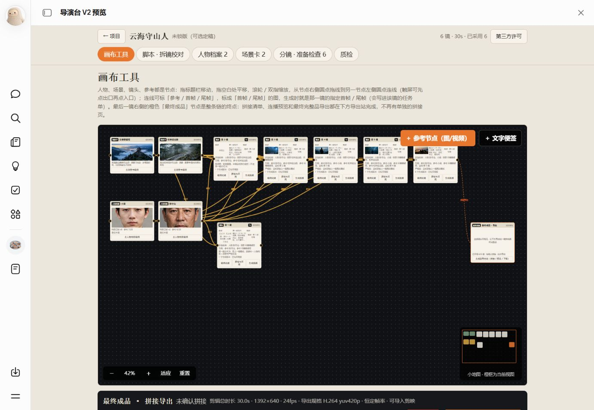
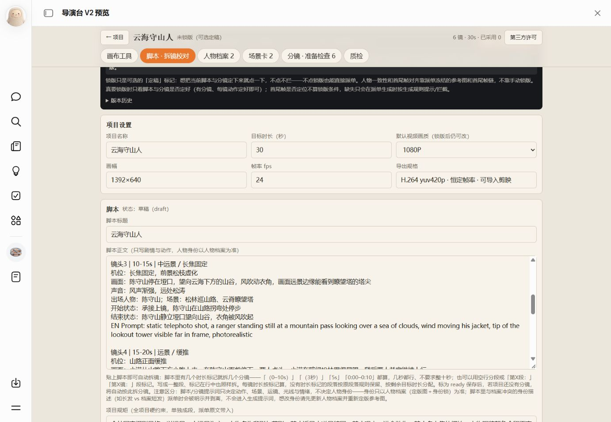
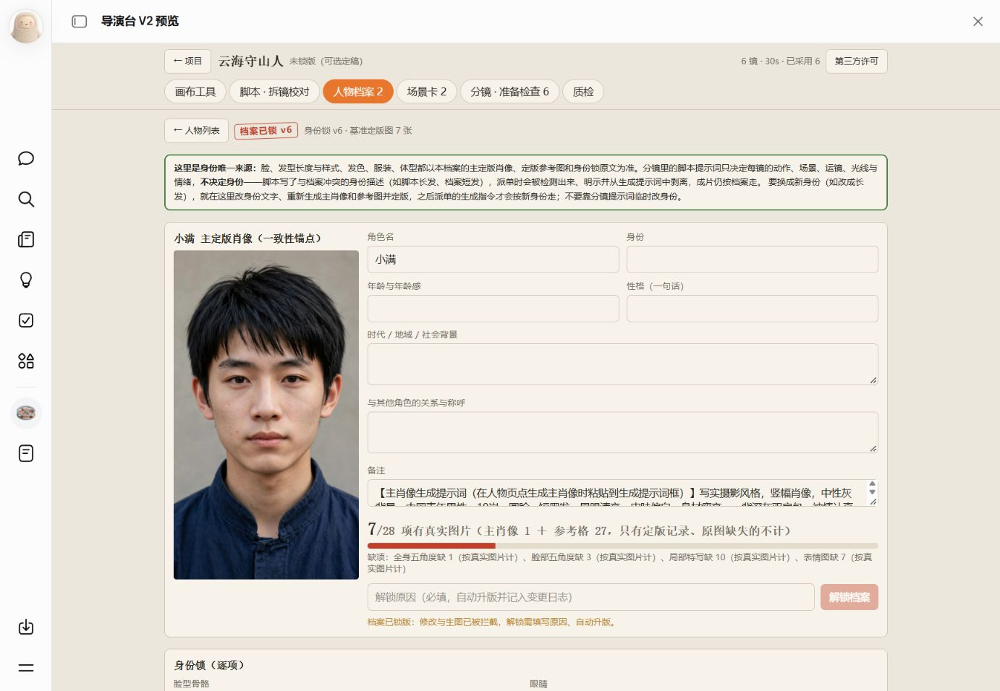
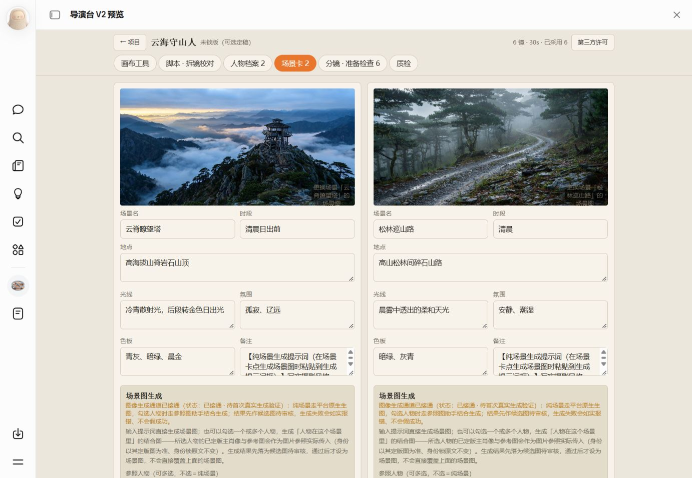
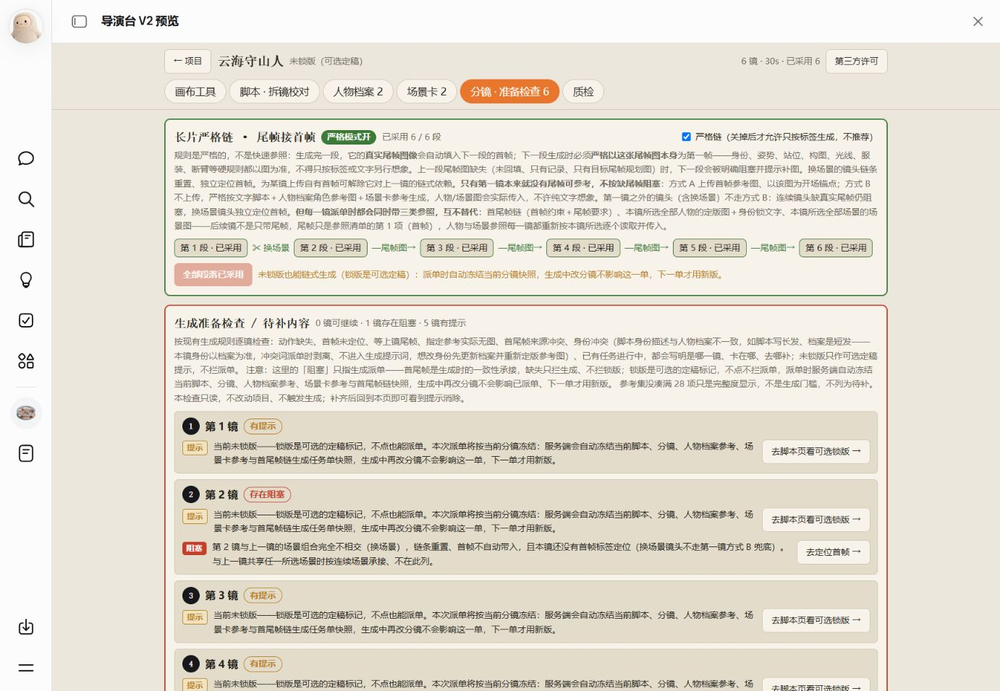
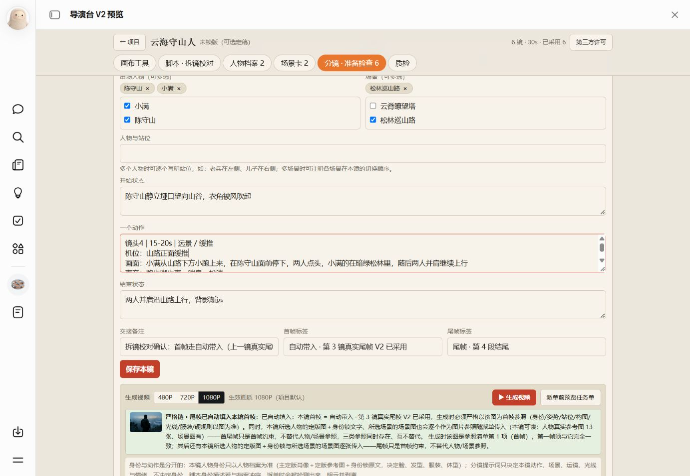
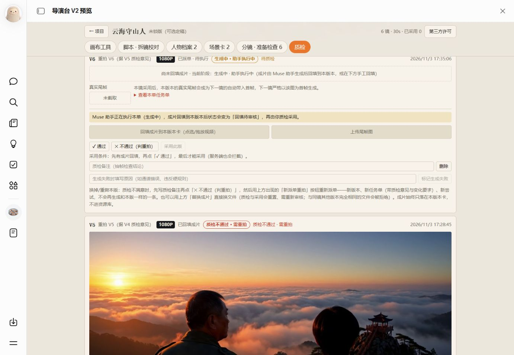

# Muse导演台

把脚本、人物、场景、分镜与生成任务放在同一个导演工作台里，逐镜组织参考素材、审核版本，并接续首尾帧。

欢迎开发者在此基础上进行二次开发，继续完善功能。本次发布主要分享导演台的设计思路、工作流程与连接方式。

> 本工具通过人物档案、场景参照和首尾帧衔接，尽可能保持生成内容的一致性。实际效果仍受模型及生成过程影响，无法保证每次完全一致，需逐镜质检并按需重拍。

当前代码基线：**v0.4.0** · React + TypeScript + Bun · **需要 Muse 宿主能力**

[界面预览](#界面预览) · [制作流程](#制作流程) · [运行条件](DEPENDENCIES.md) · [版本变化](RELEASE-NOTES.md) · [参与维护](CONTRIBUTING.md)

## 界面预览

以下为导演台的实际使用界面，展示从脚本准备到逐镜质检的制作环节。

### 画布工具

在同一画布中查看人物、场景、镜头与成品节点，梳理参考连接和镜头接续关系。



### 脚本

编写项目脚本，查看片长、画幅等制作设置，为拆镜与逐镜校对准备内容。



### 人物档案

集中管理人物信息、主肖像和参考图，为不同镜头提供统一的人物参照。



### 场景设置

维护场景图片、地点、光线、氛围和色调，让镜头制作有明确的环境参照。



### 分镜设置

逐镜查看准备状态与缺项提示，核对首尾帧接续要求。



为镜头选择人物与场景，描述起始状态、动作和结束状态，并查看任务预览及生成入口。



### 质检重拍

查看生成版本和已有画面，记录通过或不通过的审核结果，逐镜处理需要重拍的内容。



## 制作流程

| 环节 | 工作内容 |
| --- | --- |
| 项目 | 组织项目、片长与制作规则 |
| 脚本 | 编写脚本、拆镜与校对镜头内容 |
| 人物与场景 | 维护人物档案、场景卡及参考素材 |
| 画布 | 组织节点、参考关系和镜头连接 |
| 分镜与任务 | 设置镜头动作、景别、首尾状态，组织生成任务 |
| 审核与采用 | 查看生成版本、记录质检结果并采用合适版本 |
| 接续与成品 | 按现有首尾帧规则接续镜头，处理拼接和导出 |

代码保留以上流程的现有实现。生成、存储、任务执行和媒体处理依赖宿主提供的服务，完整制作流程仍需在目标环境验收。

## 工程目录

```text
client/             前端页面、样式和应用交互
server/src/         业务动作、数据模型和特权实现
drizzle/            数据库迁移及迁移日志
docs/*.jpg          界面截图
docs/source-checksums.json  v0.4.0 工程文件校验基线
.github/ISSUE_TEMPLATE/    问题与功能建议模板
```

## 已完成的检查

- 19 个代码文件语法、18 个脚本转译和 1 个 CSS 转换检查通过；
- JSON、31 处相对导入及 TypeScript 配置继承检查通过；
- 3 项数据库迁移在独立内存数据库执行通过；
- 32 个工程文件与源码归档的 SHA256 一致。

以上为源码归档检查，不包含完整宿主构建、跨账号部署或收费生成验收。工程校验基线只覆盖代码与工程配置，不覆盖后续维护的文档及截图。

## 参与维护

问题反馈请说明所在页面、操作步骤、实际结果和预期结果。截图、日志与样例提交前请移除私人项目内容、密钥和账号信息。具体约定见 [CONTRIBUTING.md](CONTRIBUTING.md)。

## 许可与发布状态

目前为私有仓库整理阶段，尚未发布公开版本。项目许可证待所有者决定，暂不附带 LICENSE；不应将许可待定理解为已授权自由使用或再分发。第三方依赖遵循各自许可，平台 SDK 的使用条件需要单独确认。
